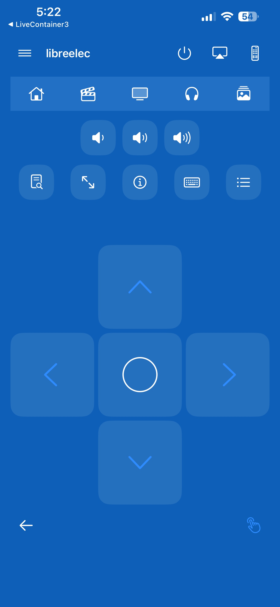
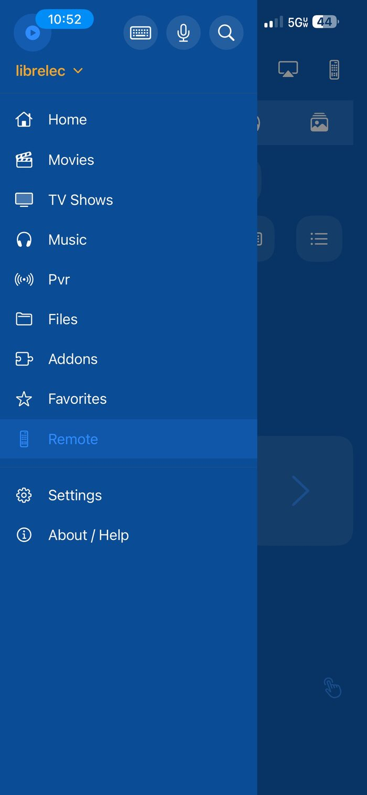

# YatseRemote — iOS Kodi remote

[](https://github.com/bpawnzZ/yatse-ios/actions/workflows/build-ipa.yml)
[](https://github.com/bpawnzZ/yatse-ios/actions/workflows/tests.yml)
[](https://github.com/bpawnzZ/yatse-ios/releases/latest)
[](LICENSE)
[](#requirements)

**Download the latest build →** [github.com/bpawnzZ/yatse-ios/releases/latest](https://github.com/bpawnzZ/yatse-ios/releases/latest)
— an unsigned IPA you re-sign with your own Apple ID. No developer account, no
App Store, every feature unlocked.

A from-scratch SwiftUI remote for Kodi, written against a specification
reverse-engineered from the **Yatse 12.0.0** Android APK. Clean-room: the
protocol surface (method names, parameter properties, discovery records, default
ports) came from static analysis of the shipped artifact; the Swift here is
original code written from that spec and the public Kodi JSON-RPC v13 docs.

The full reverse-engineering report lives outside this repo with the APK:

```
~/reverseEngineer/yatse/REPORT.md      # findings, evidence IDs, method tables
~/reverseEngineer/yatse/probe-evidence.txt   # live Kodi 21.3 payload validation
```

See [`docs/CLEANROOM.md`](docs/CLEANROOM.md) for what was and was not taken.

## Screenshots

The Remote. The drawer control stays pinned top-left, including on the screens
pushed inside a destination, so you can leave a folder for the Remote without
first going back to the top:



The drawer. Favorites is a destination, and each destination remembers the place
you last reached inside it for the session:



## What it does

| Area | Implemented |
|---|---|
| Hosts | add / edit / delete, Basic auth, password in Keychain, HTTP or HTTPS, Wake-on-LAN (MAC + port) |
| Discovery | Bonjour `_xbmc-jsonrpc-h._tcp` / `_xbmc-jsonrpc._tcp` |
| Now playing | full-screen overlay opened from the mini-player: see-through artwork backdrop, a seek slider with elapsed/duration, and Info |
| Transport | previous / rewind / play-pause / forward / next / stop in the Now Playing overlay; back, fullscreen, info, keyboard and context tiles on the remote |
| Streams | audio-stream and subtitle pickers (including subtitles off) and a video-zoom control, in the Now Playing overlay |
| Shell | host-centric: slide-out drawer (Home, Movies, TV Shows, Music, Pvr, Files, Addons, Favorites, Remote, then Settings and About) with a host header and switcher, and a persistent mini-player while a player is active |
| Remote | one screen (no tabs): pinned status, shortcut, volume and utility tile rows; a directional pad that fills the screen below them (accent arrows, outlined select), a bare Back control and a touchpad toggle; keyboard text entry; the current item's artwork as a blurred background with translucent tiles while playing |
| Queue | playlist jump / remove / clear, shown in the Now Playing overlay |
| Library | Movies and TV Shows as a two-column poster grid; Artists → Albums and Episodes as lists; paged at 60 rows, tap to play |
| Addons | video add-ons only, as a two-column poster grid; tapping one browses the content it exposes on the host, also as a grid; long-press to enable/disable it or save it as a favourite |
| Favorites | saved places as a two-column poster grid carrying their artwork; saved by long-pressing a folder inside a video add-on, removed by long-pressing the tile |
| Status | connection state, server name + version, in-app error surface |
| Self-check | ordered, read-only, per-layer connection diagnostic with a copyable redacted report and persisted per-host status |

## App shell

The app is host-centric. Before a host is chosen it shows the host picker; once
one is active the root becomes a shell scoped to that host, and player state is
owned by an app-level `Session` (not by a screen), so playback and the live event
stream survive moving between destinations.

- **Drawer** — a slide-over list with a host header (name, switcher, keyboard /
  mic / search actions) and the destinations above, Favorites among them.
  Selecting the current host again is a no-op; deleting the active host returns
  the app to the picker. **Each destination remembers the place you last reached
  inside it** for the session, so leaving Addons for the Remote and coming back
  restores that folder rather than resetting to the top.
- **Mini-player** — pinned above every destination while a player is active, with
  a thumbnail, the title, and stop / play-pause / next. Tapping it opens the
  Now Playing overlay.
- **Now Playing** — a full-screen overlay over a see-through rendering of the
  current item's artwork: a seek slider with elapsed/duration, previous / rewind /
  play-pause / forward / next / stop, repeat and shuffle, Info, audio and subtitle
  pickers (subtitles can be turned off), a video-zoom control, and the queue.
- **Remote** — a single screen with no tabs that does not scroll: the app bar, the
  shortcut strip (Home, Movies, TV Shows, Music, Pictures), volume and utility
  tiles, then a directional pad that fills every point left on the screen, with a
  bare Back arrow and a touchpad toggle beneath it. While something plays, the
  item's artwork is the blurred background and the tiles turn translucent.
- **Library** — Movies and TV Shows browse as a two-column poster grid; Artists
  and Albums, and a show's episodes, browse as lists.
- **Addons** — the video add-ons installed on the host, as a poster grid. Tapping
  one browses the content it exposes at `plugin://<addonid>/`, presented the same
  way (add-on content is a grid, a filesystem folder stays a list). A long press
  offers enabling/disabling the add-on and saving it as a favourite.
- **Favorites** — the places you saved, as a poster grid with their artwork. A
  favourite is added by long-pressing a folder inside a video add-on, and removed
  by long-pressing its tile. The drawer no longer lists one row per favourite.
- **Not on every screen** — the drawer control is on the destinations and on the
  screens pushed inside them, so you can leave a folder for the Remote without
  first going back to the top.
- **Not implemented** — Pvr shows a placeholder naming the destination rather than
  a dead end.

## Connection self-check

The host list and the remote each expose a **Check** action. It runs a fixed,
ordered, **read-only** probe sequence against one saved host and reports the
outcome of *every* probe — including the ones it did not reach — instead of only
the first failure. One run therefore names the layer that is broken rather than a
symptom, across six layers: reachability, credentials/identity, library read,
artwork fetch, notification channel, and reported server compatibility.

The result is shown live in a sheet, can be copied as a plain-text report
(app version, scheme/host/port, server name and version, per-probe outcome and
detail) that never contains the host password, and the last outcome is persisted
per host so the host list distinguishes **never checked** from **checked and
failed** (naming the failing layer and the time).

Read-only is enforced mechanically: the runner issues only methods from a fixed
allowlist and refuses anything outside it, so a diagnostic cannot disturb what is
currently playing.

The same sequence runs headless from a development host:

```bash
export KODI_HOST=http://10.13.13.7:8080
export KODI_USER=...        # supplied via environment only — never stored in this repo
export KODI_PASS=...
python3 scripts/check-host.py
```

`scripts/check-host.py` reads the host, username and password **only** from the
environment (`KODI_HOST`, `KODI_USER`, `KODI_PASS`), defines no defaults, and
exits non-zero with a clear message if any is missing. It uses the Python
standard library only — no dependency is worth adding for one socket check.

## Not implemented (deliberately, with reasons)

- **Plex / Emby / Jellyfin backends** — each is a second, unrelated protocol
  stack. Yatse ships all four; this app is the Kodi backend done properly.
- **SSDP/UPnP discovery and DLNA casting** — iOS gates multicast to
  `239.255.255.250:1900` behind `com.apple.developer.networking.multicast`,
  which a free-signed sideload build cannot carry. Bonjour needs no entitlement.
- **Offline download / on-device transcode** — Yatse does this with its bundled
  `libffmpegJNI.so`; a real port means shipping ffmpeg, not wiring JSON-RPC.
- **PVR / EPG, widgets, wearables, CarPlay, Tasker-style plugin surfaces,
  billing** — platform-specific to Android.

## Licensing — everything is unlocked

There is no unlocker, no trial, no in-app purchase, no ad SDK and no feature
flag anywhere in this codebase. `grep -riE 'unlock|premium|licen[cs]|billing|trial|paywall' YatseRemote/`
matches exactly one thing: `NSLock`'s `unlock()` in `KodiClient`. Every feature
this app ships is on for every user, permanently.

Yatse's own resource strings show what the Android app gates behind its one-time
Unlocker purchase (`str_unlocker_benefits_title2` "Pro features",
`str_locked_function_detail_trial`, `str_start_trial_description`): extra colour
themes (`str_color_unlocker`), the offline download queue (`str_download_*`,
`str_save_downloads`), and streaming/transcoding with the BubbleUPnP
trial-limited to 10 minutes per session. None of those subsystems exist in this
app — they are absent, not locked, and no gate was ported to sit in front of
them. The features that *are* implemented (library browsing, queue, remote,
full non-paginated queue) have no limits attached.

## Requirements

- iOS 17 or newer (built with the iOS 26 SDK on CI)
- A Kodi box (tested against Kodi 21.3-Omega) with **Settings → Services →
  Control → Allow remote control via HTTP** enabled
- The Kodi image endpoint is behind the same Basic auth as JSON-RPC, so set a
  username/password or artwork will not load

## Build it

CI does the building; there is no macOS step in this workflow and no signing
certificate anywhere.

```bash
# locally, on macOS:
brew install xcodegen
xcodegen generate      # writes YatseRemote.xcodeproj from project.yml
open YatseRemote.xcodeproj
```

`YatseRemote.xcodeproj` is generated and gitignored — `project.yml` is the
source of truth.

### CI

`.github/workflows/build-ipa.yml` runs on push to `main`, on tags, on PRs, and
on demand:

1. `xcodegen generate`
2. `xcodebuild build` for `generic/platform=iOS` with every signing setting
   forced off on the command line
3. packages `Payload/YatseRemote.app` into `YatseRemote-unsigned.ipa`, stripping
   `_CodeSignature` and `embedded.mobileprovision`
4. verifies the archive and that no signature survives, then uploads the IPA and
   its SHA-256

`.github/workflows/tests.yml` is separate: the unit tests run on a simulator with
ad-hoc signing, and a flaky simulator run can never block an IPA.

### Install on a device

Every push to `main` publishes a release, so the newest build is always at the
[latest release](https://github.com/bpawnzZ/yatse-ios/releases/latest):

```bash
curl -LO https://github.com/bpawnzZ/yatse-ios/releases/latest/download/YatseRemote-unsigned.ipa
curl -LO https://github.com/bpawnzZ/yatse-ios/releases/latest/download/YatseRemote-unsigned.ipa.sha256
shasum -a 256 -c YatseRemote-unsigned.ipa.sha256
```

The IPA is unsigned on purpose — SideStore, AltStore or Sideloadly re-sign it
with your own Apple ID. The same file is also an Actions artifact for 30 days,
but releases are the ones that stick around.

Free re-signing caveat: the app needs no special entitlements, so nothing here
degrades after re-signing. Local-network access is granted per app by iOS on
first use — accept the prompt or discovery and JSON-RPC both fail.

## Traps worth knowing

- Kodi's JSON-RPC HTTP endpoint is `/jsonrpc` on port 8080 by default, and in
  principle the WebSocket upgrade is served on that same port. On the box this
  was measured against, an upgrade to `:8080` returns **HTTP 200** and only
  `:9090` returns `101` — the app builds its socket URL on the HTTP port, which
  is why live push updates do not land yet. Nothing depends on the socket: a 1 Hz
  `Player.GetActivePlayers` poll is what keeps the now-playing bar honest.
- Notifications arrive interleaved with responses on the WebSocket, so the first
  frame after a call is not necessarily that call's reply. Match on `method`
  (notifications) vs `id` (responses).
- Kodi omits fields that do not apply to an item (`season` on a movie,
  `showtitle` on a song), and returns `artist` as a string in
  `AudioLibrary.GetArtists` but as an array in `GetSongs`. Every model decodes
  leniently for this reason.
- Artwork arrives as `image://http%3a%2f%2f.../`. Strip the `image://` prefix,
  percent-decode, and drop the trailing slash.
- `System.FriendlyName` exists in Yatse's method table but Kodi 21.3 answers
  `-32601 Method not found`. Server identity comes from
  `Application.GetProperties` instead.

## Tests

```bash
xcodebuild test -project YatseRemote.xcodeproj -scheme YatseRemote \
  -destination 'platform=iOS Simulator,name=iPhone 17' \
  -only-testing:YatseRemoteTests
```

The fixtures in `YatseRemoteTests` are verbatim responses captured from a live
Kodi 21.3 box, including `currentsubtitle: {}` and the `-32601` error envelope.

## License

MIT — see [`LICENSE`](LICENSE). Use it, fork it, ship it.

The Swift here is original code. What came from the Android app is the
*protocol*: method names, parameter properties, discovery records and default
ports — facts about an interface, not creative expression.
[`docs/CLEANROOM.md`](docs/CLEANROOM.md) records exactly where that line sits.
No Yatse code, resources, strings or artwork are used, and no decompiled body was
ever copied. "Yatse" is the name of the Android app this was specified from, not
the name of this project.
