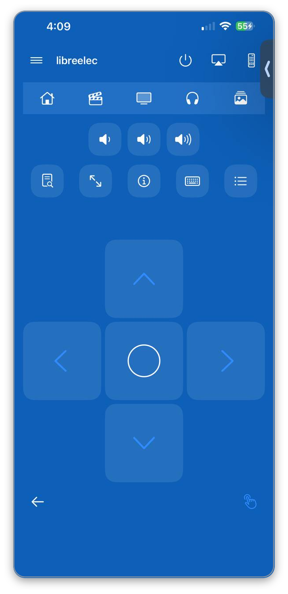
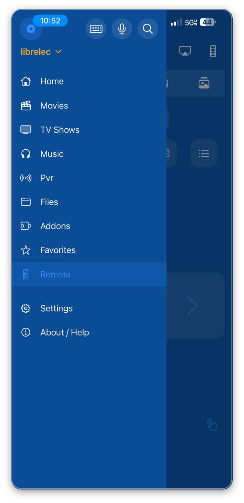

# YatseRemote — iOS Kodi remote

[](https://github.com/bpawnzZ/yatse-ios/actions/workflows/build-ipa.yml)
[](https://github.com/bpawnzZ/yatse-ios/actions/workflows/tests.yml)
[](https://github.com/bpawnzZ/yatse-ios/releases/latest)
[](LICENSE)
[](#requirements)

**Download the latest build →** [github.com/bpawnzZ/yatse-ios/releases/latest](https://github.com/bpawnzZ/yatse-ios/releases/latest)
— an unsigned IPA you re-sign with your own Apple ID. No developer account, no
App Store, every feature unlocked.

A Kodi remote for your pocket: it finds your box, remembers it, and hands you the
library, the playback controls and the remote itself. No account, no server in the
middle, nothing held back.

> **Unofficial, personal build — not affiliated with Team Kodi, Yatse or Apple.**
> One person's project: no company, foundation or upstream project stands behind it,
> and nobody distributes it but this repository. Every build says so in its release
> notes and in the app under **About / Help**. It contains no Kodi or Yatse code,
> strings or artwork, and no developer account is involved anywhere — the full
> statement is under [Trademarks and affiliation](#trademarks-and-affiliation).

A from-scratch SwiftUI remote for Kodi, written against a specification
reverse-engineered from the **Yatse 12.0.0** Android APK. Clean-room: the
protocol surface (method names, parameter properties, discovery records, default
ports) came from static analysis of the shipped artifact; the Swift here is
original code written from that spec and the public Kodi JSON-RPC v13 docs.

## Screenshots

<table>
  <tr>
    <td align="center" width="50%">
      <a href="docs/screenshots/remote-framed.png"></a>
    </td>
    <td align="center" width="50%">
      <a href="docs/screenshots/drawer-framed.png"></a>
    </td>
  </tr>
  <tr>
    <td align="center"><sub><b>The Remote</b><br>One screen, no tabs: status, shortcuts, volume, the d-pad, and a bare Back arrow.</sub></td>
    <td align="center"><sub><b>The drawer</b><br>Every destination, with a host header and a switcher. Favorites lives here.</sub></td>
  </tr>
</table>

Tap either one for the full-size image. The pair is side by side rather than stacked
so the first screenful of this page is still the pitch and the feature list, not two
full-width phone screenshots.

The drawer control stays pinned top-left on the screens pushed inside a destination,
so you can leave a folder for the Remote without first going back to the top — and
every browse screen now carries a Remote button of its own, in the toolbar next to the
layout control.

## What it does

| Area | Implemented |
|---|---|
| Hosts | add / edit / delete, Basic auth, password in Keychain, HTTP or HTTPS, Wake-on-LAN (MAC + port) |
| Discovery | Bonjour `_xbmc-jsonrpc-h._tcp` / `_xbmc-jsonrpc._tcp` |
| Launch | reconnects to the last host you used; if it has gone or does not answer, the picker comes back with the reason |
| Now playing | full-screen overlay opened from the mini-player: see-through artwork backdrop, a seek slider with elapsed/duration, and Info |
| Transport | previous / rewind / play-pause / forward / next / stop in the Now Playing overlay; fullscreen, info, keyboard and menu tiles on the remote; while a video plays fullscreen the arrow keys seek, and Kodi escalates the jump on its own — 10s → 30s → 1min → 3min → 5min |
| Streams | audio-stream and subtitle pickers (including subtitles off) and a video-zoom control, in the Now Playing overlay |
| Shell | host-centric: slide-out drawer (Home, Movies, TV Shows, Music, Pvr, Files, Addons, Favorites, Remote, then Settings and About) with a host header and switcher, a persistent mini-player while a player is active, and a Remote button on every browse screen's toolbar |
| Remote | one screen (no tabs): pinned status, shortcut, volume and utility tile rows; a directional pad that fills the screen below them (accent arrows, outlined select), a bare Back control and a touchpad toggle; keyboard text entry; the current item's artwork as a blurred background with translucent tiles while playing; during fullscreen playback the pad's centre press raises Kodi's on-screen controls instead of selecting |
| Player info | the far-left utility tile asks Kodi for its process overlay — resolution, video and audio codec, hardware or software decoding — and asks again to close it |
| Touchpad | swipe to move, tap to select: how far and how fast you swipe decides how far Kodi moves, up to 8 steps from one gesture |
| Gestures | pull up on the playback bar to open the full player, pull down on it to close; a sideways drag does neither, because that bar is made of buttons you drag across; long press a tile or row to save it as a favourite |
| Queue | playlist jump / remove / clear, shown in the Now Playing overlay |
| Library | Movies and TV Shows, Artists → Albums, and a show's episodes; paged at 60 rows, tap to play |
| Layout | one app-wide setting — **2-wide grid, the default**, or 3-wide, 4-wide and a list — switched from any browse screen's toolbar and remembered across launches |
| Addons | video add-ons only; tapping one browses the content it exposes on the host; long-press to enable/disable it or save it as a favourite |
| Favorites | saved places carrying their artwork; added and removed by long press only, on a show, artist, add-on, folder or Files source |
| Status | connection state, server name + version, in-app error surface |
| Self-check | ordered, read-only, per-layer connection diagnostic with a copyable redacted report and persisted per-host status |

## App shell

The app is host-centric. Before a host is chosen it shows the host picker; once
one is active the root becomes a shell scoped to that host, and player state is
owned by an app-level `Session` (not by a screen), so playback and the live event
stream survive moving between destinations. **At launch it reconnects to the last
host you used**, so opening the app puts you straight back in the shell for your box
rather than at a list you have to read.

- **Drawer** — a slide-over list with a host header (name, switcher, keyboard /
  mic / search actions) and the destinations above, Favorites among them.
  Selecting the current host again is a no-op; deleting the active host returns
  the app to the picker. **Each destination remembers the place you last reached
  inside it** for the session, so leaving Addons for the Remote and coming back
  restores that folder rather than resetting to the top — and a long list also comes
  back at the row you had scrolled to.
- **Mini-player** — pinned above every destination while a player is active, with
  a thumbnail, the title, and stop / play-pause / next. Tapping it opens the
  Now Playing overlay.
- **Now Playing** — a full-screen overlay over a see-through rendering of the
  current item's artwork: a seek slider with elapsed/duration, previous / rewind /
  play-pause / forward / next / stop, repeat and shuffle, Info, audio and subtitle
  pickers (subtitles can be turned off), a video-zoom control, and the queue.
- **Remote** — a single screen with no tabs that does not scroll: the app bar, the
  shortcut strip (Home, Movies, TV Shows, Music, Pictures), the volume tiles, the
  utility row (player info, fullscreen, info, keyboard, menu), then a directional pad
  that fills every point left on the screen, with a bare Back arrow and a touchpad
  toggle beneath it. While something plays, the item's artwork is the blurred
  background and the tiles turn translucent. **While a video plays fullscreen the pad
  changes job**: the arrows seek, and the centre press raises Kodi's on-screen
  controls, because that is what a video wants — moving a highlight is for menus.
  The far-left utility tile is the player-info overlay (resolution, codecs, and
  whether decoding is hardware or software); inside fullscreen playback it is what
  you reach for instead of guessing why a file stutters.
- **Library** — Movies and TV Shows, Artists → Albums, and a show's episodes.
- **Layout** — one app-wide setting rather than a per-screen one, because these are
  all the same kind of screen: **2-wide grid (the default)**, 3-wide, 4-wide, or a
  list. It is switched from the toolbar of any browse screen, applies to every one
  of them, and is remembered across launches. Tiles give up their detail line as they
  get denser, so four across stays readable.
- **Addons** — the video add-ons installed on the host, as a poster grid. Tapping
  one browses the content it exposes at `plugin://<addonid>/`, presented the same
  way. A long press offers enabling/disabling the add-on and saving it as a
  favourite.
- **Favorites** — the places you saved, carrying their artwork. **A favourite is
  added and removed by long press only**: long-press a show, artist, add-on, folder
  or Files source to save it, long-press its tile to remove it. A file is never
  offered, because a favourite names a place you can come back to. The drawer no
  longer lists one row per favourite.
- **Return to the Remote** — a Remote button sits in every browse screen's toolbar,
  immediately left of the layout control, so the Remote is one tap away instead of a
  trip through the drawer. It takes the same path the drawer row does, so the folder
  you were in is still remembered when you come back to it. The drawer control itself
  stays on the destinations and on the screens pushed inside them.
- **Not implemented** — Pvr shows a placeholder naming the destination rather than
  a dead end.

## Connection self-check

The host list and the remote each expose a **Check** action. It runs a fixed,
ordered, **read-only** probe sequence against one saved host and reports the
outcome of *every* probe — including the ones it did not reach — instead of only
the first failure. One run therefore names the layer that is broken rather than a
symptom, across six layers: reachability, credentials/identity, library read,
artwork fetch, notification channel, and reported server compatibility.

The result is shown live in a sheet, can be copied as a plain-text report
(app version, scheme/host/port, server name and version, per-probe outcome and
detail) that never contains the host password, and the last outcome is persisted
per host so the host list distinguishes **never checked** from **checked and
failed** (naming the failing layer and the time).

Read-only is enforced mechanically: the runner issues only methods from a fixed
allowlist and refuses anything outside it, so a diagnostic cannot disturb what is
currently playing.

The same sequence runs headless from a development host:

```bash
export KODI_HOST=http://10.13.13.7:8080
export KODI_USER=...        # supplied via environment only — never stored in this repo
export KODI_PASS=...
python3 scripts/check-host.py
```

`scripts/check-host.py` reads the host, username and password **only** from the
environment (`KODI_HOST`, `KODI_USER`, `KODI_PASS`), defines no defaults, and
exits non-zero with a clear message if any is missing. It uses the Python
standard library only — no dependency is worth adding for one socket check.

## Not implemented (deliberately, with reasons)

- **Plex / Emby / Jellyfin backends** — each is a second, unrelated protocol
  stack. Yatse ships all four; this app is the Kodi backend done properly.
- **SSDP/UPnP discovery and DLNA casting** — iOS gates multicast to
  `239.255.255.250:1900` behind `com.apple.developer.networking.multicast`,
  which a free-signed sideload build cannot carry. Bonjour needs no entitlement.
- **Offline download / on-device transcode** — Yatse does this with its bundled
  `libffmpegJNI.so`; a real port means shipping ffmpeg, not wiring JSON-RPC.
- **PVR / EPG, widgets, wearables, CarPlay, Tasker-style plugin surfaces,
  billing** — platform-specific to Android.

## Licensing — everything is unlocked

There is no unlocker, no trial, no in-app purchase, no ad SDK and no feature
flag anywhere in this codebase. `grep -riE 'unlock|premium|licen[cs]|billing|trial|paywall' YatseRemote/`
matches exactly one thing: `NSLock`'s `unlock()` in `KodiClient`. Every feature
this app ships is on for every user, permanently.

Yatse's own resource strings show what the Android app gates behind its one-time
Unlocker purchase (`str_unlocker_benefits_title2` "Pro features",
`str_locked_function_detail_trial`, `str_start_trial_description`): extra colour
themes (`str_color_unlocker`), the offline download queue (`str_download_*`,
`str_save_downloads`), and streaming/transcoding with the BubbleUPnP
trial-limited to 10 minutes per session. None of those subsystems exist in this
app — they are absent, not locked, and no gate was ported to sit in front of
them. The features that *are* implemented (library browsing, queue, remote,
full non-paginated queue) have no limits attached.

## Requirements

- iOS 17 or newer (built with the iOS 26 SDK on CI)
- A Kodi box (tested against Kodi 21.3-Omega) with **Settings → Services →
  Control → Allow remote control via HTTP** enabled
- The Kodi image endpoint is behind the same Basic auth as JSON-RPC, so set a
  username/password or artwork will not load

## Build it

CI does the building; there is no macOS step in this workflow and no signing
certificate anywhere.

```bash
# locally, on macOS:
brew install xcodegen
xcodegen generate      # writes YatseRemote.xcodeproj from project.yml
open YatseRemote.xcodeproj
```

`YatseRemote.xcodeproj` is generated and gitignored — `project.yml` is the
source of truth.

### CI

`.github/workflows/build-ipa.yml` runs on push to `main`, on tags, on PRs, and
on demand:

1. `xcodegen generate`
2. `xcodebuild build` for `generic/platform=iOS` with every signing setting
   forced off on the command line
3. packages `Payload/YatseRemote.app` into `YatseRemote-unsigned.ipa`, stripping
   `_CodeSignature` and `embedded.mobileprovision`
4. verifies the archive and that no signature survives, then uploads the IPA and
   its SHA-256

`.github/workflows/tests.yml` is separate: the unit tests run on a simulator with
ad-hoc signing, and a flaky simulator run can never block an IPA.

### Install on a device

Every push to `main` publishes a release, so the newest build is always at the
[latest release](https://github.com/bpawnzZ/yatse-ios/releases/latest):

```bash
curl -LO https://github.com/bpawnzZ/yatse-ios/releases/latest/download/YatseRemote-unsigned.ipa
curl -LO https://github.com/bpawnzZ/yatse-ios/releases/latest/download/YatseRemote-unsigned.ipa.sha256
shasum -a 256 -c YatseRemote-unsigned.ipa.sha256
```

The IPA is unsigned on purpose — SideStore, AltStore or Sideloadly re-sign it
with your own Apple ID. The same file is also an Actions artifact for 30 days,
but releases are the ones that stick around.

Free re-signing caveat: the app needs no special entitlements, so nothing here
degrades after re-signing. Local-network access is granted per app by iOS on
first use — accept the prompt or discovery and JSON-RPC both fail.

## Traps worth knowing

- Kodi's JSON-RPC HTTP endpoint is `/jsonrpc` on port 8080 by default, and in
  principle the WebSocket upgrade is served on that same port. On the box this
  was measured against, an upgrade to `:8080` returns **HTTP 200** and only
  `:9090` returns `101` — the app builds its socket URL on the HTTP port, which
  is why live push updates do not land yet. Nothing depends on the socket: a 1 Hz
  `Player.GetActivePlayers` poll is what keeps the now-playing bar honest.
- Notifications arrive interleaved with responses on the WebSocket, so the first
  frame after a call is not necessarily that call's reply. Match on `method`
  (notifications) vs `id` (responses).
- Kodi omits fields that do not apply to an item (`season` on a movie,
  `showtitle` on a song), and returns `artist` as a string in
  `AudioLibrary.GetArtists` but as an array in `GetSongs`. Every model decodes
  leniently for this reason.
- Artwork arrives as `image://http%3a%2f%2f.../`. Strip the `image://` prefix,
  percent-decode, and drop the trailing slash.
- `System.FriendlyName` exists in Yatse's method table but Kodi 21.3 answers
  `-32601 Method not found`. Server identity comes from
  `Application.GetProperties` instead.

## Tests

```bash
xcodebuild test -project YatseRemote.xcodeproj -scheme YatseRemote \
  -destination 'platform=iOS Simulator,name=iPhone 17' \
  -only-testing:YatseRemoteTests
```

The fixtures in `YatseRemoteTests` are verbatim responses captured from a live
Kodi 21.3 box, including `currentsubtitle: {}` and the `-32601` error envelope.

## License

MIT — see [`LICENSE`](LICENSE). Use it, fork it, ship it.

The Swift here is original code. What came from the Android app is the
*protocol*: method names, parameter properties, discovery records and default
ports — facts about an interface, not creative expression.
[`docs/CLEANROOM.md`](docs/CLEANROOM.md) records exactly where that line sits.
No Yatse code, resources, strings or artwork are used, and no decompiled body was
ever copied. "Yatse" is the name of the Android app this was specified from, not
the name of this project.

The artifacts that specification came out of live with the APK on a development
host, not in this repo:

```
~/reverseEngineer/yatse/REPORT.md            # findings, evidence IDs, method tables
~/reverseEngineer/yatse/probe-evidence.txt   # live Kodi 21.3 payload validation
```

### Trademarks and affiliation

An **unofficial, personal** project. Not affiliated with, authorised by, sponsored
by or endorsed by Team Kodi / the XBMC Foundation, by Yatse or its author, or by
Apple — and not an official build of any of them. No Kodi or Yatse code, strings,
iconography or artwork is included, and no developer account sits behind it.

"Kodi", "XBMC" and "Yatse" are the trademarks of their respective owners. They
appear here only to identify what this app talks to and what it was specified from:
nominative use, with no claim to the marks and no implication of endorsement. If a
rights holder would rather a name were not used this way, open an issue and it will
be changed or removed.

MIT covers the code in this repository. It grants nothing in anyone else's
trademarks, and it does not make this an official client of anything.
